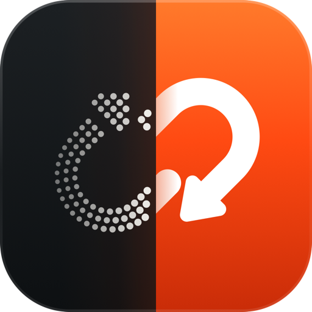
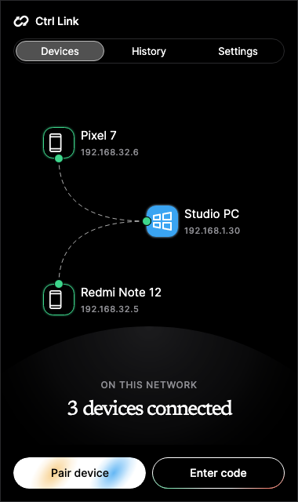
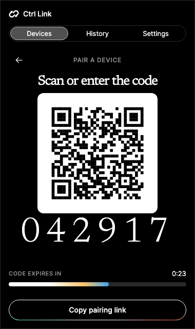
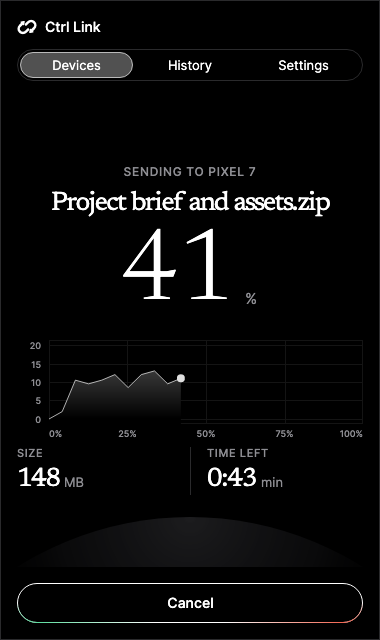
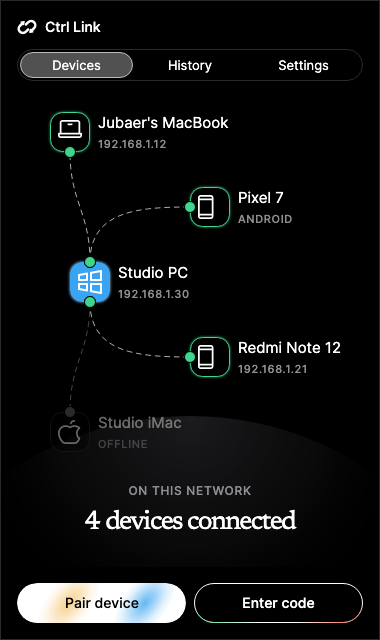
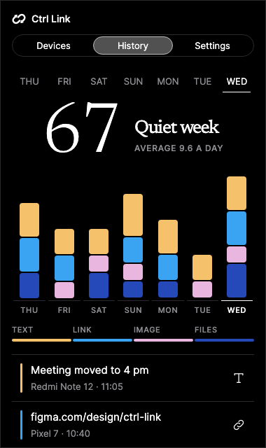
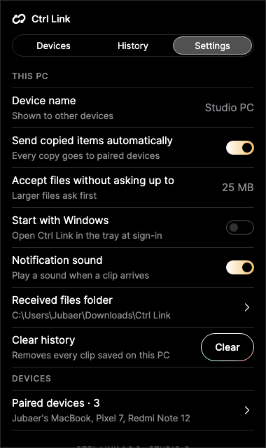

<p align="center">
  
</p>

<h1 align="center">Ctrl Link</h1>

<p align="center">
  Copy on one device, paste on another.<br>
  Text, links, images, videos and any file — over your local network, end-to-end encrypted, no cloud.<br>
  <sub>Designed and developed by <b>Focotik agency</b></sub>
</p>

<p align="center">
  
  
  
  
  
</p>

<p align="center">
  <a href="../../releases/latest/download/CtrlLink-Windows-x64-Setup.exe"></a>
  <a href="../../releases/latest/download/CtrlLink-macOS.zip"></a>
  <a href="../../releases/latest/download/CtrlLink-Android.apk"></a>
</p>

<p align="center">
  
  
  
</p>

## Download

| Platform | Download | Notes |
|---|---|---|
| **Windows 10/11** | [Installer (x64)](../../releases/latest/download/CtrlLink-Windows-x64-Setup.exe) · [Arm64](../../releases/latest/download/CtrlLink-Windows-arm64-Setup.exe) | No admin needed. SmartScreen will warn once: see [security warnings](#security-warnings-on-first-launch) |
| **macOS 14+** (Apple silicon) | [CtrlLink-macOS.zip](../../releases/latest/download/CtrlLink-macOS.zip) | Unzip, move to Applications. macOS will warn once: see [security warnings](#security-warnings-on-first-launch) |
| **Android 8.0+** | [CtrlLink-Android.apk](../../releases/latest/download/CtrlLink-Android.apk) | Open on the phone and allow installing from this source |

All versions and checksums: **[Releases](../../releases)**. Install on two devices on the same Wi-Fi, then pair with the QR code or 6-digit code.

## Security warnings on first launch

Windows and macOS will warn you the first time you open Ctrl Link. **This is expected.** Ctrl Link is a free, open-source app and the builds are not yet signed with a paid Microsoft code-signing certificate or notarized by Apple, so the operating system can't confirm who made them. The warning is about the missing signature, not about anything the app does. The full source code is in this repository and the release builds are made by GitHub Actions straight from it.

**Windows — "Windows protected your PC" (Microsoft Defender SmartScreen)**
1. Click **More info**.
2. Check that the app is `CtrlLink-Windows-…-Setup.exe`, then click **Run anyway**.
3. If your browser flags the download, choose **Keep** (Edge: **⋯ → Keep → Show more → Keep anyway**).
4. When Windows Firewall asks, allow Ctrl Link on **Private networks** so your other devices can reach it.

**macOS — "Apple could not verify "Ctrl Link" is free of malware"**
1. Unzip and move **Ctrl Link** to **Applications**, then open it once. When the warning appears, click **Done** (not *Move to Trash*).
2. Open **System Settings → Privacy & Security**, scroll down to the message about Ctrl Link, and click **Open Anyway**. Confirm with your password or Touch ID.
3. Open Ctrl Link again and click **Open**. You only do this once.

On macOS 14 you can instead right-click the app → **Open** → **Open**.

**Make sure your download is genuine**
- Download only from this repository's [Releases](../../releases) page.
- Compare the file with `SHA256SUMS.txt` from the same release:
  - macOS: `shasum -a 256 CtrlLink-macOS.zip`
  - Windows (PowerShell): `Get-FileHash .\CtrlLink-Windows-x64-Setup.exe`
  The result must match the line for that file.

These warnings go away once the builds are code-signed (Windows) and notarized (macOS).

## Features

- **Clipboard sync** — copy text or a link on one device, it's on the clipboard of your other devices.
- **Files of any size** — images, videos and documents stream device to device with live progress.
- **Multiple devices, all in sync** — connect several Macs, PCs and phones at once. Anything you copy on one goes to all of them, with each device's live status on the Devices screen.
- **Pair once** — scan a QR code or type a 6-digit code. Paired devices find each other on the network (mDNS) and reconnect on their own.
- **Private by design** — X25519 key exchange, AES-256-GCM sessions, nothing leaves your network. No accounts, no servers.
- **History** — recent clips, filterable by type, kept locally and clearable any time.
- **Native on every platform** — a menu-bar app on Mac, a tray app on Windows, a Compose app (with Share target and Quick Settings tile) on Android.

## Platforms

| Platform | Stack | Folder |
|---|---|---|
| macOS 14+ | Swift / SwiftUI, Swift Package Manager | [`Codebase/Mac`](Codebase/Mac) |
| Android 8.0+ (API 26) | Kotlin / Jetpack Compose, Gradle | [`Codebase/Android`](Codebase/Android) |
| Windows 10/11 (x64, Arm64) | C# / .NET 10, Avalonia, Velopack installer | [`Codebase/Windows`](Codebase/Windows) |
| Protocol | Spec, test vectors, Node.js reference peer | [`Codebase/protocol`](Codebase/protocol) |

All three apps implement the same wire contract, [`PROTOCOL.md`](Codebase/protocol/PROTOCOL.md), and are tested byte-for-byte against shared [test vectors](Codebase/protocol/test-vectors.json) and against the Node reference peer.

## Repository layout

```
.
├── Codebase/
│   ├── Mac/          macOS menu-bar app (SwiftPM)
│   ├── Android/      Android app (Gradle)
│   ├── Windows/      Windows tray app (.NET solution)
│   ├── protocol/     PROTOCOL.md, test-vectors.json, test-peer/ (Node)
│   ├── design/       DESIGN.md, logo, Newsreader font (OFL)
│   └── tools/        Android toolchain + copy-sync helper scripts
├── docs/
│   ├── BUILDING.md   toolchains, build and test commands
│   └── images/       icon, logo, screenshots
└── .github/          CI workflow, issue and PR templates
```

## Build from source

```bash
git clone <this-repo> ctrl-link && cd ctrl-link/Codebase
```

**Mac**

```bash
cd Mac && ./scripts/build-app.sh && open "build/Ctrl Link.app"
```

**Android**

```bash
cd Android && ./gradlew assembleDebug
```

APK: `Android/app/build/outputs/apk/debug/app-debug.apk`

**Windows** (built from macOS or Linux with the .NET 10 SDK)

```bash
Windows/scripts/build-installer.sh
```

Installers: `Windows/dist/CtrlLink-<version>-Setup-x64.exe` and `-arm64.exe`

Full toolchain setup, tests and signing notes: **[docs/BUILDING.md](docs/BUILDING.md)**.

## How it works

1. **Discover** — each app advertises `_ctrllink._tcp` over mDNS on the local network.
2. **Pair** — one device shows a QR code / 6-digit code; the other scans or types it. Both derive a long-term pair key (X25519 + HKDF) and confirm with a short authentication string.
3. **Connect** — paired devices open a TCP session, authenticate with the pair key and switch to AES-256-GCM framed messages.
4. **Sync** — clipboard changes and file offers flow as encrypted frames; large files are chunked and streamed.

Details in [`Codebase/protocol/PROTOCOL.md`](Codebase/protocol/PROTOCOL.md).

## Screenshots

| More devices | History | Settings |
|---|---|---|
|  |  |  |

## Contributing

Pull requests are welcome — see [CONTRIBUTING.md](CONTRIBUTING.md). For security issues, please follow [SECURITY.md](SECURITY.md) instead of opening a public issue.

## Credits

Ctrl Link is designed, developed and maintained by **Focotik agency**: the Mac, Android and Windows apps and the protocol.

Display type is [Newsreader](https://fonts.google.com/specimen/Newsreader), licensed under the [SIL Open Font License](Codebase/design/fonts/OFL.txt).

## License

[MIT](LICENSE) © 2026 Focotik agency. The Newsreader font keeps its own [OFL license](Codebase/design/fonts/OFL.txt).
